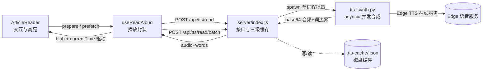

# 逐段朗读功能详解

> 本文专门描述文章正文的「逐段朗读」与「逐句朗读（笔记英文行 → 正文句子循环）」：用户可见交互、前端播放与高亮、后端合成与三级缓存、提速策略、词级高亮原理、接口协议、环境与排错。
> 关键位置：`ArticleReader.vue`（交互与高亮）、`src/composables/useReadAloud.js`（播放与预取封装）、`server/index.js`（接口与缓存）、`server/tts_synth.py`（Edge TTS 合成）、`src/utils/selectionText.js`（词定位）、`src/components/NotePanel.vue`（笔记英文行数据源）。
> 本文统一用「组件 + 方法名 / 函数名」定位，不写死代码行号，避免代码调整后引用漂移。

---

## 一、功能总览

「逐段朗读」把文章正文用微软 Edge TTS 合成成真实 mp3，前端本地 `<audio>` 播放，并用 Edge 返回的词级时间戳驱动**逐词高亮**（当前词黄底 + 滚动到视图中央）。支持三种音色，默认 Andrew（与旧 Web Speech API 音色一致）。

| 特性 | 说明 |
|------|------|
| 音色 | 默认 Andrew（`en-US-AndrewNeural`，即微软「Microsoft Andrew Online (Natural)」）；可切换 Emma（`en-US-EmmaMultilingualNeural`）、Ryan（`en-GB-RyanNeural`）。在左侧「音频准备情况」面板点选音色行切换（原工具条循环按钮已移除），选择存 localStorage。三音色在打开文章后按此顺序串行预热、缓存 key 含音色互不串味 |
| 播放载体 | 服务端合成 mp3 → 前端 blob → `<audio>` 本地播放（不再是浏览器黑盒 TTS） |
| 朗读入口 | 标题左侧「循环朗读全文」（读到末尾回第 1 段、再点停止）；段首仅保留「段循环」与「逐句循环」两个按钮（原「朗读本段」按钮已移除）；笔记卡片右上角悬停显现「循环播放该句」按钮（复用逐句循环、须能在正文定位到）。四类入口互斥，任一时刻只一处出声 |
| 高亮 | 逐词黄底 `.reading-current`，与音频进度严格同步；覆盖笔记命中蓝底 |
| 缓存 | 服务端内存 + 服务端磁盘 + 前端 blob 三级；刷新页面 / 重启后端都不丢 |
| 提速 | 打开文章即后台预热 + 播放时滑动窗口预取 + Python 单进程并发合成 |
| 单例 | 切段 / 停止 / 切文章 / 卸载自动停止，任一时刻只有一段在播 |
| 逐句朗读 | 笔记英文行经 `findTextInParagraphs` 定位到正文句子，段首「逐句朗读」按钮优先从**选区起点所在句的句首**开始循环（跨句选区只取首句），无选区则从本段第一句开始；`←` / `→` 跨段切句并立即循环新句，到头 / 尾回绕。句子序列按正文出现顺序（段 → 段内偏移）排，定位不到的笔记行不参与。切到哪句，右侧笔记面板就把对应笔记卡片滚到视图中央并加绿色描边高亮（停止即撤销；同一句循环重播不重复滚动） |
| 准备情况查看 | 左侧工具条「音频准备情况」按钮打开面板，只读展示三音色的内存 / 磁盘 / 生成中 / 未准备段数与逐段明细，可一键触发预热 |

### 与旧实现（Web Speech API）的差别

早期用浏览器 `speechSynthesis`：音频是浏览器黑盒、无法导出/缓存，每次播放或跳转都要在线合成；且 `charIndex` 词边界不准，数字与相邻词的分组反复出问题（见 [第五节](#五词级高亮与数字分组问题)）。现方案把合成放到服务端，音频可缓存、可跳转、无在线播放延迟，词边界由 Edge TTS 权威给出。

---

## 二、用户可见交互

所有交互入口都在 `ArticleReader.vue` 模板中，朗读相关的 ref 有 `readingPara`（当前段下标，-1 为无）、`readingRange`（当前词在段全文的 `[start,end)`）、`readingAll`（全文播放中）、`readStart`（选区起点 `{para, offset}`）、`loopPara`（循环播放的段下标，-1 为无）、`sentenceIdx`（逐句朗读当前句在 `sentenceList` 中的下标，-1 为未在逐句模式）；循环子段状态用普通变量 `loopSelRange`（点循环按钮时已有的选区 `{para,start,end}`，`null` 表示循环整段）。`sentenceList` 是 computed：把笔记英文行（`{text, noteIndex}[]`）用 `annotationBridge.findTextInParagraphs` 定位到正文，得 `{text, noteIdx, para, start, end}` 并按正文出现顺序排序；`noteIdx` 来自 `noteIndex`，是**原笔记卡片下标**（空英文行被过滤后数组下标会错位，故必须显式携带）。当前句对应的卡片下标经 App 共享的 reactive `sentenceState.noteIndex` 传给 NotePanel（ArticleReader 写、NotePanel 读），驱动笔记面板跳转与高亮。

| 操作 | 行为 | 入口函数 |
|------|------|----------|
| 点标题左侧「循环朗读全文」按钮 | 从第 1 段连续循环朗读，读到末尾自动回到第 1 段；再点停止。朗读中按钮常亮（方块图标）。与段 / 句 / 卡片循环互斥 | `onReadFull()` / `readFullFrom()` / `stopReading()` |
| 点段首循环按钮 | **先选中文字再点**：循环选中内容；**未选中直接点**：循环整段。两者都跟随词级高亮 / 滚动；无新选区时再点同一按钮 = 停止。段首原「朗读本段」按钮已移除，只读一段请用段循环 | `onLoopParagraph(i)` → `captureLoopSelection(i)` → `playLoop(i)` |
| 点段首「逐句朗读本段」按钮（循环按钮下方） | 有选中内容时从**选区起点所在句的句首**开始循环（跨句只取首句，落在本段句子间隙则取后面最近一句）；无选区时从本段第一句（笔记英文行定位到正文的句子）开始**循环朗读当前句**；再点当前句所在段的按钮 = 停止。本段无可朗读句子时提示「本段没有可朗读的笔记句子」 | `onSentenceLoop(i)` → `playSentence(idx)` |
| 悬停某段按 `C` | 等价点该段「段循环」按钮：该段有选中内容则循环选中内容、否则循环整段；再按停止。要求无修饰键、焦点不在输入框内；目标段由 `hoveredPara` 决定 | `onReadingKeydown()` → `onLoopParagraph(hoveredPara)` |
| 悬停某段按 `Z` | 等价点该段「逐句朗读」按钮：有选中内容从选中句句首开始，否则从本段第一句开始循环；再按停止。守卫同上 | `onReadingKeydown()` → `onSentenceLoop(hoveredPara)` |
| 悬停笔记卡片点右上角「循环播放该句」按钮 | 复用正文逐句循环：把该卡片英文行定位到正文后循环朗读该句；再点当前卡片 = 停止，点别的卡片 = 切换目标。**该句在正文定位不到时提示、不播放**。与正文朗读（全文 / 段循环 / 逐句）互斥，启动时先停正文；按钮循环播放时常亮 | `NotePanel.toggleCardLoop(i)` → `sentenceState.cardLoopNoteIndex/nonce` → `ArticleReader` watch → `playSentence(idx)` |
| 悬停笔记卡片按 `Z` | 等价点该卡片「循环播放该句」按钮：循环朗读该句对应的正文句，再按停止；该句在正文定位不到则不播。目标卡片由 `hoveredCardIndex` 决定，输入框内不拦截；与正文段落悬停的 `Z` 天然互斥 | `NotePanel._noteAnnotKeyHandler` → `toggleCardLoop(hoveredCardIndex)` |
| 重点集中视图按 `↑` / `↓` | 在左侧重点词汇列表逐项切换选中，右侧边栏笔记卡片同步切换并滚入视野；到头 / 尾停住，输入框内不拦截 | `NotePanel._noteAnnotKeyHandler` → `moveMarkedSelection(delta)` |
| 重点集中视图按 `Z` / 点侧栏卡片朗读按钮 | 循环朗读右侧边栏当前笔记对应的正文句，再按停止；定位不到正文则提示。侧栏只读、除朗读按钮外无其它交互入口 | `NotePanel._noteAnnotKeyHandler` → `toggleCardLoop(activeNoteIndex)` |
| 逐句朗读中按 `→` / `←` | 下一句 / 上一句，**可跨段**：在当前全局句子序列里移动，到头 / 尾回绕；切完立即循环朗读新句；定位不到正文的笔记行自动跳过。输入框 / textarea / contenteditable 内不拦截 | `onReadingKeydown()` → `switchSentence(delta)` |
| 朗读中按空格键 | 暂停 / 继续当前音频；输入框 / textarea / contenteditable 内不拦截，非朗读状态不生效 | `onReadingKeydown()` → `readAloud.togglePause()` |
| 正文选中文字（全文循环朗读中） | 选区起点由 `captureReadStart()` 记录；朗读中改选文字并松手会从新选处继续读（全文循环不退出） | `onReaderMouseUp()` → `onReadParagraph(i, true)` 消费 `readStart` |
| 朗读中改选文字并松手 | 立即从新选处重读（全文模式下继续往后读，不退出全文）；**循环模式下不打断当前循环、也不自动换子段**（要换就再点一次循环按钮） | `onReaderMouseUp()` → `onReadParagraph(i, true)` |
| 先选中本段文字再点循环按钮 | 记录选区为子段范围后**立即清掉原生选区**，循环选中内容（复用整段音频、`startMs` 跳入 / `endMs` 停在词尾，只高亮选中词），不再抢占选区 | `onLoopParagraph()` → `speakParagraph(..., {end, range})` → `play({startMs,endMs})` |
| 循环中重新选中并点同一循环按钮 | 以新选区**重启**子段循环；若此时无选区，则再点 = 停止循环 | `onLoopParagraph(i)` |
| 拖拽选词期间 | 冻结朗读高亮，避免 `<mark>` 重建打断选区、高亮跳动干扰选词 | `onReaderMouseDown()` / `onReaderMouseUp()` 维护 `draggingSelection` |
| 切段 / 停止 / 切文章 / 卸载 | 停止播放、清高亮（含逐句状态 `sentenceIdx`） | `stopReading()` / `watch(() => props.articleId, …)` / `onUnmounted()` |
| 在「音频准备情况」面板点音色行 | 直接切换为 Andrew / Emma / Ryan，**不中断当前朗读：下一个词即生效**（同段文本取新音色缓存，按词偏移对齐后 seek 到下一个词续播；无下一个词则本段保持原声），点当前音色不重复操作，选择持久化，缓存已预热可直接点播 | `AudioStatusPanel` emit `select-voice` → `ArticleReader.selectVoice(id)` → `setVoice()` |
| 点左侧工具条「音频准备情况」按钮 | 开 / 关查看器面板：按需查询当前文章三音色的内存 / 磁盘 / 生成中 / 未准备段数、各音色已缓存音频大小与逐段明细（面板查询**只读、不触发合成**）；面板开启时先检测一次，未全部就绪才每秒自动重测、全部就绪即停止；发现未准备段且无在途合成时通知父组件自动重跑预热；面板内可「立即准备」触发预热，完成后自动刷新；点面板 ✕ 或点面板以外区域均可关闭（外部那次点击照常生效，不被遮罩吞掉） | `toggleAudioStatus()` → `AudioStatusPanel` → `fetchReadTtsStatus()` → `POST /api/tts/read/status` |
| 编辑文章并保存 | 仅当**段落文本真的变化**才重新预热三音色（只改标题 / 仅换行空白不重下）；未变段落命中缓存不重下，只下载新文本 / 失败段 | `ArticlePage.saveEdit()` 对比段落快照 → 置 `audioForceTick = 1` → `watch` → `warmupAll()` |

**音频准备情况查看器**（`ArticleReader.toggleAudioStatus()` → `AudioStatusPanel.vue`）：左侧工具条的柱状图按钮开 / 关面板（按钮高亮表示打开态）。关闭有三种方式：再点该按钮、点面板内 ✕、或点面板以外区域（`AudioStatusPanel` 的 document click 监听，`panelEl.contains(e.target)` 排除面板内部；用监听而非全屏 overlay，使面板外的那次点击照常生效；延迟一个宏任务注册避免开面板那次点击误关）。面板在打开 / 点刷新 / 后台预热完成（面板开着）时请求 `POST /api/tts/read/status`，**打开时检测一次，未全部就绪才以 1 秒间隔自调度下一次，全部就绪（无 `miss` / `pending`）立即停止**（复用同一 `refresh()`，`reqId` 保证只应用最新结果；关闭 / 卸载清定时器；`loading` 仅首次查询为真，轮询不再翻转按钮状态），按当前文章与预热完全相同的段落文本 × 三音色，逐段读服务端内存 Map、磁盘 `.json` 存在性与进行中去重（**查询本身只读、绝不触发合成、不回填内存**）。轮询结果若存在 `miss` 且没有任何 `pending`，面板 `emit('auto-retry')` → `ArticleReader.autoRetryWarmup()` 重跑预热：只下载未缓存 / 失败段；有 `pending` 时只等待、不重复下载，父组件预热进行中（面板 `warming` prop）也直接跳过，避免从头重启在途批次；预热失败后下一次检测会再触发，直到全部就绪。每个音色展示「已就绪 / 总段数」进度条（绿=内存命中、蓝=磁盘命中、黄=生成中、灰=未准备）与四类计数，并在图例右侧显示该音色当前文章的磁盘缓存音频大小（自动选 B / KB / MB，统计 `.json` 文件字节数，含 base64 音频与词边界），当前音色加「当前」标记；可展开逐段明细看每段三音色的来源徽标（A/E/R）。**点任一音色行即切换朗读音色**（原左侧工具条循环按钮已移除）：`as-voice-pick` 手型光标 + 悬停高亮，`emit('select-voice', v.id)` → `ArticleReader.selectVoice(id)` 调 `setVoice()` + `stopReading()` + 提示，点当前音色直接 return 不重复操作；当前音色行仍加「当前」标记。面板内「立即准备」调 `warmupAll()`，其禁用态由父组件 `warming`（真实预热状态）控制，不再随每秒状态查询闪烁，完成后自动刷新统计；**进入文章 / 编辑保存触发的后台预热完成后，面板若开着也会自动刷新一次**（预热后台异步启动，打开面板那一刻的 pending / miss 快照会过期）；切文章 / 正文变化后面板若开着也会自动重新查询，避免显示上一篇文章的统计。刷新由 `warmupAll()` 完成分支统一触发，「立即准备」不重复请求。

**选区起点计算**（`captureReadStart()`）：用 Range 从段首量到选区起点得字符偏移，再用 `buildWordRanges` 对齐到 `\S+` 词区间的词首。点击朗读 / 循环 / 逐句按钮本身不算选词（`mousedown` 命中 `.para-read-btn, .para-loop-btn, .para-sentence-btn` 直接返回），且 `mouseup` 早于 `click`，不能清空刚记录的选区起点。循环模式的子段选区**只在点循环按钮那一刻**由 `captureLoopSelection(i)` 同时量起止偏移并对齐词首 / 词尾（词尾取「起点在 end 之前」的最后一个词，避免选区尾部空格 / 标点把下一个词也算进来；存进 `loopSelRange`），随后立即清掉原生选区；循环中再选文字不会自动改子段，需再点一次循环按钮。

**选中位置跳转朗读（时间戳 seek，非切片）**：`speakParagraph(i, start)` 始终用**整段 `fullText`** 作缓存 key（与预热/预取一致、命中缓存毫秒级），不在 `start` 处切文本——旧实现用 `fullText.slice(start)` 会生成新 key、必然 miss、在线等 ~6 秒，且因提前清选区导致"背景立即消失 + 跳转很慢"。现在 `start`（词首字符偏移）只在已定位好的 `timedWords` 里找覆盖它的词，取其 `timeMs` 交给 `play({startMs})` 在 `loadedmetadata` 后 `audio.currentTime` 跳转（回退 60ms 确保选中词高亮必触发一次）。原生选区的清除也**延后到 `play` 的 `onStart`（真正开播）**：合成/加载等待期间保留选中背景，开播瞬间才消失。自动续播（全文下一段 / 末尾回卷、段循环、逐句循环）传 `preserveSelection:true`，开播时**不清原生选区**；换段高亮也推迟到首个无选区的词再切，避免回卷时抢走用户正在选的内容。循环播放选中子段时复用同一载荷，额外传 `endMs`（选区最后一个词的 `timeMs + durMs`）由 `play()` 的 `tick()` **逐帧**检查到点当作本遍结束（早期用 `audio.ontimeupdate`，约 250ms 才触发一次，会多播到选中范围后的 1~2 个词；选区在末段时因后面没词才听不出来），不另起合成、不增加缓存 key。

**滚动策略**（`scrollReadingWord()`）：仅当当前词不在 `.reader-content` 可视区（留 24px 边距）时才用 `scrollIntoView({block:'center', behavior:'auto'})` 瞬时滚动；视口内完全不动，用户可稳定拖拽选区，避免 smooth 动画导致页面持续漂移。

**单例与竞态**（`readEpoch`）：切段 / 停止 / 重读时 `readEpoch++`，`speakParagraph()` 的 async 合成完成后若发现 `epoch !== readEpoch` 就丢弃结果，防止旧的合成覆盖新播放状态。

---

## 三、整体架构与数据流



一条「读某段」的完整链路：

1. `ArticleReader.speakParagraph(i,start)` 用 `paraSpeechInfo` 算出 `{text, fullText, startOffset}`，调 `readAloud.prepare()`。
2. `useReadAloud.prepare()` 先查前端 blob 缓存；未命中则 `POST /api/tts/read`。
3. 后端 `getReadTts()` 依次查内存 → 磁盘；都未命中则 `spawn` Python 合成，写回内存 + 磁盘。
4. 前端 `decodePayload()` 把 base64 音频转 blob/objectURL，词边界经 `locateTtsWords` 定位到段全文坐标，组成 `{url, timedWords}` 写入前端缓存。
5. `useReadAloud.play()` 用 `<audio>` 播放，`requestAnimationFrame` 按 `currentTime` 找到当前词触发 `onWord`，`ArticleReader` 写 `readingRange` 高亮并滚动。

**逐句朗读的数据链路**（句子来源 → 正文坐标 → 循环播放）：

1. `NotePanel` 解析笔记（`parseRaw`）后，`watch(notes)` 把所有笔记卡片的 `english` 行写入 App.vue provide 的 `noteSentences`（`Ref<{text,noteIndex}[]>`，`noteIndex` 为原笔记卡片下标；空英文行过滤后仍不错位）。NotePanel 常驻、切换文章时随 `articleId` 重新加载，句子列表同步刷新。
2. `ArticleReader` inject `noteSentences` 与 `annotationBridge`，`sentenceList` computed 逐句调用 `findTextInParagraphs(text)`（归一化大小写 / 引号后等长匹配）得到 `{paragraphIndex, startOffset, endOffset}`，转成 `{text, noteIdx, para, start, end}`（`noteIdx` 即上一步的 `noteIndex`）；定位不到的（`para=-1`，笔记改写 / 正文改过）排在末尾且不参与朗读。列表按 `para → start` 排序，即正文出现顺序。
3. 点段首「逐句朗读」按钮 / 按 `Z` → `onSentenceLoop(i)` 先用 `selectionStartOffsetInParagraph(i)` 取选区起点偏移，命中该句则从该句句首开始（跨句只取首句，间隙取后一句），无选区退回本段第一句 → `playSentence(idx)`；它复用 `speakParagraph(para, start, onDone, {end, range})` 的子区间播放（整段音频、不另合成，`startMs` 跳入 / `endMs` 停在词尾，`range` 限定只高亮句内词），`onDone` 里若无错且仍是同一句则重播，形成**循环当前句**。
4. `←` / `→` 走 `switchSentence(delta)`：`stopReading()` 中断当前句（代次 `readEpoch++` 使在途合成失效），在句子序列里跨段移动、跳过定位不到的句、到头 / 尾回绕，再 `playSentence(next)` 立即循环新句。
5. 复用现有单例与竞态机制：切段 / 全文 / 段循环 / 切文章 / 卸载都经 `stopReading()`，清 `sentenceIdx` 与高亮；逐句与段循环、全文朗读互斥。
6. **回跳笔记面板**：`playSentence(idx)` 在首次启动 / 切句（即 `sentenceIdx !== idx`）时把 `sentenceList[idx].noteIdx` 写入 App 共享的 `sentenceState.noteIndex`；同一句的 `onDone` 循环重播不再写，避免打断用户在笔记面板里的手动滚动。NotePanel watch 该值后调 `scrollCardToCenter(idx)`，把 `#note-N` 卡片瞬时滚到滚动区中央，并给卡片加 `.note-sentence-current`（绿色描边 + 浅底，与搜索命中的蓝底区分）；`stopReading()` 把下标置 -1 撤销高亮，面板隐藏期间切句则在 `visible` 重新为 true 时再补定位一次。
7. **笔记卡片「循环播放该句」**：悬停笔记卡片显示右上角循环按钮（`NotePanel.toggleCardLoop(i)`），写 `sentenceState.cardLoopNoteIndex = i` 并自增 `cardLoopNonce`；ArticleReader watch nonce，在 `sentenceList` 中找 `noteIdx === i` 且 `para >= 0` 的句子，先 `stopReading()`（互斥：清段 / 全文 / 逐句、并清 `cardLoopNoteIndex`，watch 里随后恢复目标下标作按钮高亮态），再 `playSentence(idx)` 循环该句。再点当前卡片把 index 置 -1 发请求 → `stopReading()` 停止；定位不到正文的句子提示「该笔记句子在正文中未找到对应位置，无法循环朗读」。正文朗读启动（全文 / 段循环 / 逐句按钮 / 切句）经 `stopReading()` 一并清 `cardLoopNoteIndex`，卡片按钮熄灭。

---

## 四、提速策略（三件套）

Edge TTS 单段合成约 **6 秒**，其中本地 `import edge_tts` 仅约 0.25 秒、空 Python 进程约 0.08 秒——**6 秒几乎全是到 Edge 远程服务的建连开销**。这个延迟无法在点朗读的瞬间消除，因此用三层手段把合成「提前」和「合并」：

### 1. 打开文章即后台预热全文（`ArticleReader.warmupAll()`）

- 触发：`watch(() => props.contentReadyTick, …)`——正文数据 / 批注 / 滚动恢复落地后才预热，确保段落文本已就绪。
- 方式：按音色 **Andrew → Emma → Ryan 顺序串行**预热（默认音色优先就绪、点播秒开；串行避免一次性三倍请求拖慢默认音色），每音色全文按每批 20 段（对齐后端 batch 上限）走 `readAloud.prefetch(items, voice.id)`，不阻塞交互；缓存 key 含音色互不串味。
- **消息提示（短暂告知、不打扰）**：预热开始**延迟 600ms** 才弹一条**自动关闭**的 info 消息（`duration: 3000`：「正在后台准备朗读音频，进度可在左侧「音频准备情况」面板查看」）；全命中缓存时预热转瞬完成、timer 被 `cancelWarmupStartMsg()` 清掉，**完全不闪提示**。逐段进度 / 缓存来源不再用常驻消息（`duration:0` + 响应式 VNode）展示——**详情一律到「音频准备情况」面板查看**。完成后弹一条**自动关闭**的汇总：全命中缓存（`downloaded === 0 && failed === 0`）弹「朗读音频已就绪 · 3 种音色（全部命中缓存 36 段）」（2.8s），有新下载弹「…（新下载 X 段，已缓存 Y 段）」（2.8s），有失败弹警告并提示「详情见面板，面板开启时会自动重试失败段」（3.2s）。汇总按 `prefetch` 返回 payload 的 `cache` 字段区分来源：`MISS`=本次下载，`HIT/DISK/DEDUP`=已有缓存命中。
- 中断：抽出 `abortWarmup()`（`warmupToken++` + `cancelWarmupStartMsg()` + `abortReadTts()`），在切文章 / 组件卸载时都调用——旧文章预热循环在下一检查点退出、面板「正在准备」提示清掉、**在途 fetch 通过 `AbortController` 取消**，避免离开文章后仍继续下载、写缓存、弹「已就绪」汇总（卸载不再漏中断）。`abortReadTts()` 取消 `useReadAloud.js` 模块级 `activeFetches` 集合里所有在途的 `/tts/read` 与 `/tts/read/batch` 请求；请求被取消后按失败落定，不写前端缓存。因前端取消无法保证后端停算，删除文章 / 文件夹永久删除时后端额外走 `cleanupTtsCacheAfterDelete()`（立即清 + 25s 延迟补清）兜住孤儿。
- 效果：利用用户打开文章到点朗读之间的浏览时间提前合成并落盘，点播时大概率已命中缓存；用户可从提示直观看到准备进度与缓存来源。

### 2. 滑动窗口预取（`ArticleReader.prefetchAhead()`）

- `readFullFrom(i)` 播放当前段时，用 `paraSpeechInfo` 收集后续 `PREFETCH_WINDOW = 4` 个非空段，`readAloud.prefetch(items, currentVoice.value)` 按当前音色一次并发合成。
- 切段时 `prepare()` 直接命中缓存即播，不再「读一段合成一段」地在线等待。
- 单段朗读（`onReadParagraph` 非全文分支）不额外预取，避免无谓请求。
- `useReadAloud.prefetch()` 为每段设**独立** pending promise（而非整批共用一个），使 `prepare()` 等待时只等目标段、不被同批其它段拖住。

### 3. Python 单进程并发合成（`server/tts_synth.py` + `synthTtsBatch()`）

- 批量接口把多段合并为**一次 spawn**，Python 进程内用 `asyncio.gather` 并发跑多段 `edge_tts.Communicate`。
- 旧方案每段 spawn 一个进程、重复付进程启动 + import 开销；实测 4 段从多进程 ~7.3s 降到单进程 ~2.9s（端到端含落盘约 6.3s）。
- 并发度 4 → 8 → 16 耗时几乎不变（都约 6–8s），瓶颈在网络建连而非并发数；单进程并发是性价比最高的方案。
- **失败自动重试**：单段合成（含超时）最多尝试 3 次，每次 `asyncio.wait_for(..., 20s)`，失败退避 1s / 2s（避开 Edge TTS 临时限流）；3 次全失败才把该段标为 `error`。Node 侧整批超时按最坏耗时 `30s + 3×20s + 3s退避 = 93s` 设置（Python 内并发，不按段数累加）。

### 实测性能数据（本地，Andrew 音色）

| 场景 | 耗时 |
|------|------|
| 单段冷合成 | 7316 ms |
| 单段命中内存 | 23 ms |
| 单段命中磁盘（重启后端后） | 58 ms |
| 4 段批量冷合成（单进程并发 + 落盘） | 6256 ms |
| 4 段批量再次请求（内存命中） | 73 ms |
| 8 段 / 16 段批量冷合成 | 7621 ms / 6347 ms（并发度饱和） |

### 缓存失效与重新下载（force）

缓存 key = sha256(文本 + 音色 + 语速)，**文本变了 key 自然变**，所以正文改动后只需重新预热，不需要也不应该强推全量重下：

| 场景 | 触发 | 行为 |
|------|------|------|
| **编辑文章后重新预热** | `saveEdit()` 成功且**段落文本真的变了**才置 `audioForceTick = 1` → 阅读器重新挂载时 watch（`immediate`，`nextTick` 等新段落落地）→ 直接 `warmupAll()`（**不清缓存、不 force**） | 只改标题、或仅换行 / 空白差异**不触发**。Andrew→Emma→Ryan 串行预热：未变段落直接命中已缓存音频（`HIT`，**不重复下载**），只有新文本段落（key miss）和之前失败的段落（无缓存）才真正合成下载。旧文本的无引用磁盘文件由 `PUT /api/articles/:id` 后的清理逻辑删除 |

> 编辑期间阅读器被 `v-if` 卸载、保存后重新挂载，故该 watch 必须 `immediate`；`startEdit()` 会把 `audioForceTick` 归零，避免"进入编辑又取消"时重挂载误触发预热。

**force 保留为底层能力**：前端 `prepare`/`prefetch` 的 `force` 参数 → 请求体 `force:true` → 后端 `getReadTts`/batch 跳过缓存强制合成并覆盖写回，标 `X-Cache: REBUILT`。**当前编辑流程不再使用它**（否则已成功的段也会被重下，浪费带宽）；`clearReadCache(voice?)` 仍可手动清空指定音色 / 全部前端 blob 缓存。

### 无用缓存清理

磁盘缓存不设容量上限，但会在以下时机自动删掉**不再被任何文章段落引用**的文件（旧文本、旧音色、已永久删除的文章）以及崩溃残留的 `.tmp`：

| 时机 | 说明 |
|------|------|
| 服务端启动 | `cleanupUnusedTtsCache('startup')` 兜底历史残留 |
| `PUT /api/articles/:id` | 请求里的 `content` 与库中不一致（真的改了正文）才触发，改标题不触发 |
| `DELETE /api/articles/:id` / `DELETE /api/folders/:id/force` | 文章被永久删除后清理其音频 |

实现：`collectLiveTtsKeys()` 用 `SELECT content FROM articles`（**含回收站文章**，恢复后仍可命中）按前端相同规则切段（`\n` 分隔、丢弃纯空白行、`normalizeQuotes`）再与三音色 × `+0%` 组合算出 sha256 集合；目录内不在集合中的 `.json` 直接删除（`.tmp` 仅删 1 分钟前的），同时清掉内存 `readTtsCache` 里的无用 key。并发调用合并为一次补跑，失败只记日志、不影响接口响应。删除类操作（文章硬删 / 文件夹永久删）走 `cleanupTtsCacheAfterDelete()`：立即清一次并在 25s 后补清一次，覆盖「前端取消在途请求但后端合成仍完成写盘、且晚于首轮清理」的竞态窗口（定时器 unref 不阻塞进程退出）。


---

## 五、词级高亮与数字分组问题

### 词边界来源：`WordBoundary`

Python 合成时用 `edge_tts.Communicate(text, voice, rate, boundary='WordBoundary')`，Edge 返回一系列 `WordBoundary` chunk，每个含 `{text, offset, duration}`（offset/duration 单位 100ns tick，÷10000 得毫秒）。

### 词定位：`locateTtsWords(words, fullText, startOffset)`（`selectionText.js`，有单测）

- Edge 的 `word.text` 就是原文片段；函数用顺序游标在 `fullText` 里 `indexOf`（大小写 / 引号 `’→'` 不敏感）定位每段 `[start,end)`，避免重复词（the … the）定位到前面。
- offset/duration 换算成 `timeMs/durMs`，返回 `[{start, end, timeMs, durMs, text}]`。
- 找不到的词直接丢弃（音频照播、仅不高亮），避免错位。
- `startOffset` 用于从选中处朗读时只在其后定位（前面的词已被截掉）。

### 播放驱动（`useReadAloud.tick()`）

`requestAnimationFrame` 每帧用 `audio.currentTime * 1000` 找最后一个 `timeMs <= t + 40` 的词（+40ms 容差提前点亮，观感更跟音频），变化时触发 `onWord`。

### 历史坑：数字与相邻词的分组

旧 Web Speech API 的词边界不稳，出现：`physical-format` 被拆开、纯数字 `2015` 被越过、带括号 `(1957)` 却能高亮、`in 2017` 中 `in` 与 `in 2017` 重复点亮、`hot 100` 应各自独立却被合并。

多轮前端猜测（就近补发、合并区间、连字符规则）都无法同时满足「不漏 / 不重复 / 不延迟」。最终方案：**由 Edge TTS 的 WordBoundary 权威给出分组**——Edge 原生把 `since 2015` 当作一个词单元返回，前端直接用其坐标高亮，不再猜测。旧的 `buildWordRanges`（仍保留，仅用于选区起点对齐）、`resolveReadingWord`（已废弃）等猜测逻辑不再参与朗读高亮。高亮投影仍走 `applyReadingHighlight` 数据驱动、不改写 DOM，批注结构不受影响。

---

## 六、三级缓存体系

| 层级 | 位置 | key | 容量 / 策略 | 说明 |
|------|------|-----|-------------|------|
| ① 服务端内存 | `server/index.js` 的 `readTtsCache` | sha256(text + NUL + voice + NUL + rate) | 上限 200 段，超限淘汰最旧 | 最快；进程重启即失 |
| ② 服务端磁盘 | `server/.tts-cache/<sha>.json` | 同上 | 无容量淘汰；启动 / 正文变更 / 永久删除后清理无引用文件 | 存 `{audio, words}`，临时文件 + `renameSync` 原子写；**跨进程 / 重启 / 刷新页面常驻**；目录已入 `.gitignore`，随项目走但不入库 |
| ③ 前端 blob | `useReadAloud.js` 模块级 `cache` | `voice + NUL + fullText` | 上限 120 段，超限 revoke 最旧的 objectURL | 跨组件实例 / 切文章复用；value = `{url, timedWords, cache}`。含音色避免切换串味；选中跳转不另切片、共用整段 key（见第二节） |

**命中顺序**：内存 → 磁盘（命中回填内存）→ 合成（写回内存 + 磁盘）。

**请求去重（并发合并）**：
- 后端 `pendingReadTts` 按 key 去重；单段接口与批量接口共享。批量内每段用独立 deferred 占位，只 resolve 自己那段的 payload，避免 `getReadTts` 命中去重时误拿到整批 map。
- 前端 `useReadAloud` 的 `pending` 按 `text` 去重；`prefetch` 已占位的段，`prepare()` 会等待该段完成再取缓存。

**cache 标记**：接口返回 / `X-Cache` 头值为 `HIT`（内存）/ `DISK`（磁盘）/ `DEDUP`（请求去重）/ `MISS`（新合成）。

---

## 七、接口协议

### `POST /api/tts/read`（单段）

```json
// 请求
{ "text": "But since 2015 its evolving formula", "voice": "en-US-AndrewNeural", "rate": "+0%" }
// 响应
{ "audio": "<base64 mp3>", "words": [{ "text": "...", "offset": 0, "duration": 0 }], "cache": "MISS" }
```

- `text` 非空且 ≤3000 字；`voice` / `rate` 可省略（默认 Andrew / `+0%`）。
- `force`（可选，布尔）：`true` 跳过缓存强制重新合成并覆盖，`X-Cache` 返回 `REBUILT`（底层能力保留，当前编辑流程不再使用）。
- 响应头 `X-Cache`：`HIT` / `DISK` / `DEDUP` / `MISS` / `REBUILT`；失败返回 502 + `{error}`。

### `POST /api/tts/read/batch`（批量预取）

```json
// 请求
{ "items": [{ "id": 0, "text": "..." }, { "id": 1, "text": "..." }], "voice": "...", "rate": "+0%" }
// 响应
{ "results": { "0": { "audio": "...", "words": [...], "cache": "MISS" }, "1": { "error": "..." } } }
```

- 最多 20 项（超出的截断）；每项文本 ≤3000 字。
- `force`（可选，布尔）：`true` 时全部项跳过缓存强制重合成，各自标 `cache: REBUILT`（底层能力保留，当前编辑流程不再使用）。
- 非 force 时先查内存 / 磁盘 / 进行中去重，只有真正未命中的段合并为**一次 spawn** 交 Python 并发合成。
- 每项带自己的 `cache` 标记；单项失败仅该项带 `error`，不拖垮整批。

### `POST /api/tts/read/status`（准备情况查询，只读）

```json
// 请求
{ "texts": ["But since 2015 its evolving formula", "..."], "voices": ["en-US-AndrewNeural"], "rate": "+0%" }
// 响应
{
  "total": 12,
  "voices": [{ "id": "en-US-AndrewNeural", "name": "Andrew", "memory": 8, "disk": 3, "pending": 0, "miss": 1, "ready": 11, "total": 12, "audioBytes": 2479616 }],
  "paragraphs": [{ "index": 0, "preview": "But since 2015...", "status": { "en-US-AndrewNeural": "disk" } }]
}
```

- `texts` 为当前文章送合成的各段全文（最多 500 项、过滤空串）；`voices` 省略则查三音色；`rate` 默认 `+0%`。
- 状态值 `memory`（内存命中）/ `disk`（磁盘命中）/ `pending`（正在合成）/ `miss`（未准备）；**只查询、不合成、不回填内存、不写磁盘**。
- `audioBytes` 为当前文章各段在该音色的磁盘缓存 `.json` 文件大小之和（`readTtsDiskSize()`，含 base64 音频与词边界）；内存命中但磁盘文件仍在的段也计入，未生成的不计。前端面板按 B / KB / MB 格式化展示。
- 缓存 key 与 `/read`、`/batch` 完全一致（同文本 + 音色 + 语速 sha256），故统计即真实就绪情况。供「音频准备情况查看器」使用。

### `server/tts_synth.py`（被 spawn 的脚本）

- stdin 读一行 JSON：`{items:[{id,text}], voice, rate}`；兼容旧单段入参 `{text}`（视作 id=0）。
- stdout 写一行 JSON：`{results:{id:{audio,words}}}`；异常时输出 `{error}` 并退出码 1。
- 内部 `asyncio.gather` 并发，单段经 `synth_one()` 自动重试 3 次（每次限时 20s、退避 1s / 2s），全部失败才仅标记该项 `error`，不拖垮整批。

---

## 八、环境与依赖

- **Python 虚拟环境**：项目父目录下的 `.venv`（当前机器 `D:\PythonFiles\.venv`），后端通过 `PYTHON_HOME`（`.env` 可覆盖）拼 `Scripts/python.exe` 调用（用 `python.exe` 而非 `pythonw.exe`，因为要读 stdout）。`spawn` 时带 `windowsHide: true`（Windows 下即 `CREATE_NO_WINDOW`），避免无控制台的后端拉起 console 版 Python 时弹出黑色 cmd 窗口。
- **编码（Windows 防乱码）**：spawn 时注入 `PYTHONUTF8=1` / `PYTHONIOENCODING=utf-8`，脚本内再用 `sys.stdin/stdout.reconfigure(encoding='utf-8')` 兜底；stdout 的 JSON 用 `ensure_ascii=True` 输出纯 ASCII，错误 / 词文本先经 `_safe_text()` 替换孤立代理项，避免 `'utf-8' codec can't encode ... surrogates not allowed` 把中文错误提示变成乱码。
- **依赖包**：`edge-tts` 7.3.1（换机重建后 `pip install edge-tts`）。详见 [python-env.md](../docs/python-env.md)。
- **网络**：需可访问 Edge 语音服务；本地部署、网络可用是提速前提。
- **重启生效**：改了 `server/index.js` / `server/tts_synth.py` 需重启后端（`npm run dev:server` 或一键脚本）才加载新代码。

---

## 九、排错

| 现象 | 可能原因 / 处理 |
|------|-----------------|
| 点朗读报「朗读音频生成失败」 | 网络不通 Edge 服务 / Python venv 缺 `edge-tts` / `PYTHON_HOME` 路径错误；看后端日志具体错误 |
| 首次点朗读仍要等几秒 | 预热未完成就点了，或该段是新增/改动过的文本（key 变了、缓存未命中）；稍等预热或先读一遍 |
| 重启后音频不丢但换了音色/语速 | key 含 voice + rate；换音色或语速会生成新缓存文件，旧文件仍在磁盘 |
| 磁盘缓存越来越大 | 无容量淘汰，但启动 / 正文变更 / 文章永久删除后会自动清理无引用文件（见第四节「无用缓存清理」）；也可手动删 `server/.tts-cache/` 下的 .json（下次重新合成） |
| 高亮与音频不同步 / 数字不高亮 | 检查 `locateTtsWords` 是否在 `fullText` 找到对应词；找不到时音频照播但不高亮（设计取舍，避免错位） |
| 换文章后残留旧词高亮 | `watch(() => props.articleId, …)` 会 `stopReading()`；若异常，检查该 watch 是否正常触发 |
| 全文朗读第一段读完就停 | `useReadAloud.play()` 的 `onended`/`onerror`/`catch` 必须先存下 `onEndCb` 再调 `stop()`（`stop()` 会清空 `onEndCb`）；早期版本先 `stop()` 再 `onEndCb?.()`，导致全文朗读的 `onDone → readFullFrom(i+1)` 从不触发 |
| 从选中位置朗读很慢 / 选区背景提前消失 | `speakParagraph` 必须用整段 `fullText` 作缓存 key（勿 `fullText.slice(start)` 切片，否则新 key 必 miss 在线等 ~6s）；`start` 只定位词的 `timeMs` 交给 `play({startMs})` 做时间戳 seek；选区清除放在 `play` 的 `onStart`（真正开播），不要提前 |
| 逐句朗读时笔记面板不跳卡 / 跳错卡 | 确认 `noteSentences` 条目带 `noteIndex`（原笔记卡片下标）且 ArticleReader 的 `sentenceList` 用它填 `noteIdx`；`playSentence` 只在 `sentenceIdx !== idx` 时写 `sentenceState.noteIndex`（循环重播不写属正常）；NotePanel 的 watch 路径为 `'sentenceState.noteIndex'`，定位依赖 DOM `#note-N`（非 `reviewMode` 的笔记列表） |

---

## 十、相关文件索引

| 文件 | 职责 |
|------|------|
| `src/components/ArticleReader.vue` | 朗读按钮 / 选区重读 / 拖选冻结 / 滚动 / 高亮投影 / 预热与预取调度 / 音色切换 / 音频准备情况查看器开关 |
| `src/components/AudioStatusPanel.vue` | 音频准备情况查看器面板：只读查询三音色缓存就绪状态、逐段明细、立即准备入口 |
| `src/api/index.js` | `fetchReadTtsStatus()` → `POST /api/tts/read/status`（只读查询） |
| `src/views/ArticlePage.vue` | `saveEdit()` 成功后对比段落快照，变化时置 `audioForceTick = 1` 触发朗读音频重新预热（只下载新文本 / 失败段）；注册 `annotationBridge`（含 `findTextInParagraphs`）供逐句定位 |
| `src/components/NotePanel.vue` | 解析笔记，`watch(notes)` 把 `{text,noteIndex}[]` 写入 `noteSentences` 供正文逐句朗读；watch `sentenceState.noteIndex` 把当前句对应笔记卡片滚到视图中央并加绿色高亮 |
| `src/App.vue` | provide `noteSentences`（笔记英文行 + 原卡片下标）与 `annotationBridge`，并以 reactive `sentenceState.noteIndex` 共享逐句朗读当前卡片下标，供 NotePanel / ArticleReader 双向联动 |
| `src/composables/useReadAloud.js` | 三种音色 `READ_VOICES` / `currentVoice` / `setVoice` + 前端播放封装 `prepare` / `prefetch`（force 仅底层保留）/ `play` / `getPlaybackState` / `switchPayload`（下一个词边界换音色，保留回调）/ `stop` / `togglePause` + `clearReadCache` + blob 缓存（key 含音色）+ 进度驱动 |
| `src/utils/selectionText.js` | `buildWordRanges`（选区起点对齐）、`locateTtsWords`（词定位）、`applyReadingHighlight`（高亮投影）、`scrollToReaderHit`（命中滚动） |
| `server/index.js` | `/api/tts/read` 与 `/api/tts/read/batch`、三级缓存、请求去重、spawn 调度 |
| `server/tts_synth.py` | Edge TTS 单进程批量合成脚本 |
| `server/.tts-cache/` | 音频磁盘缓存（gitignore 忽略） |
| `docs/python-env.md` | Python 环境与 `edge-tts` 依赖说明 |
| `README.md` | 功能概览中的「逐段朗读」条目 |
| `markdown/ARCHITECTURE.md` | 架构文档中的逐段朗读章节 |
